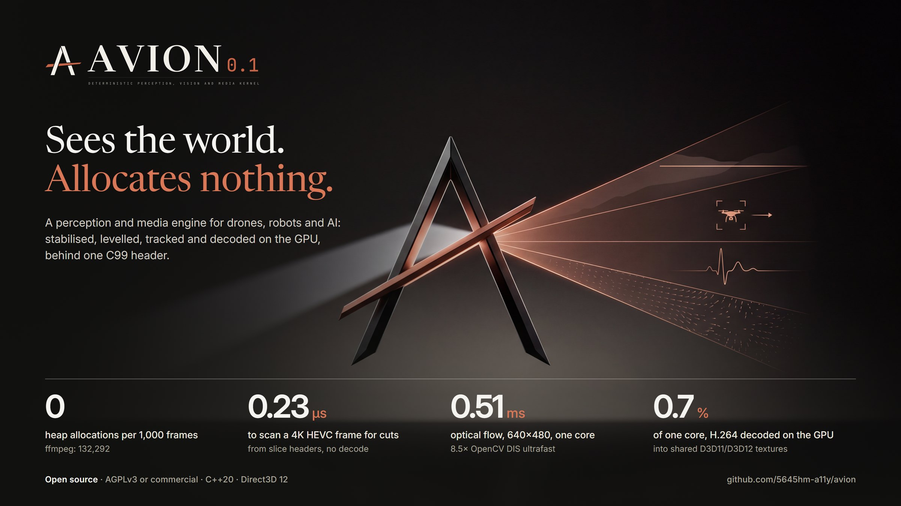
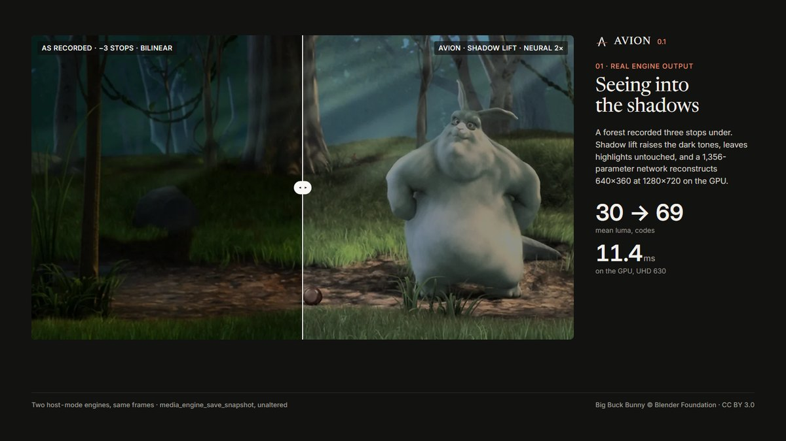
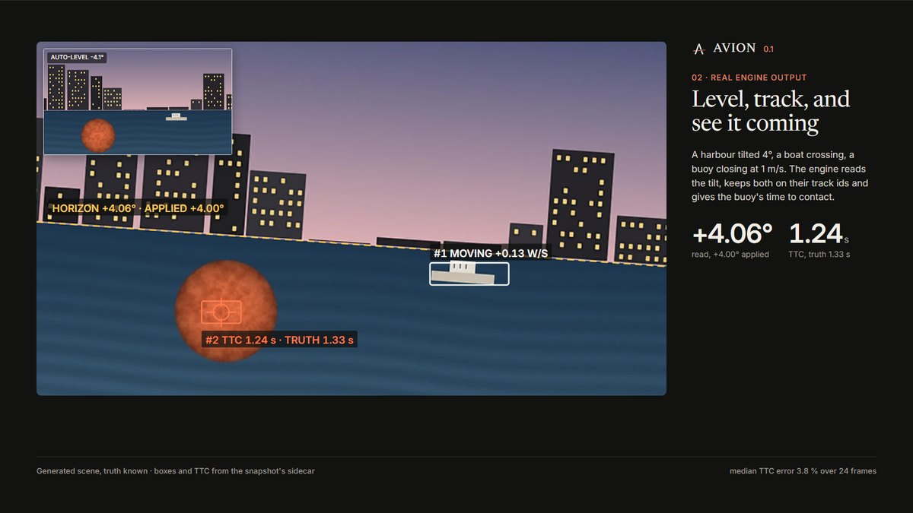
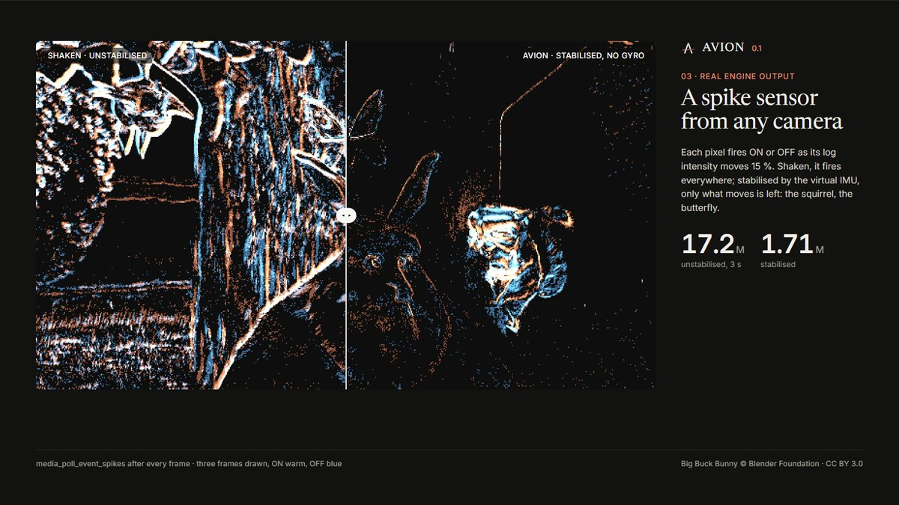
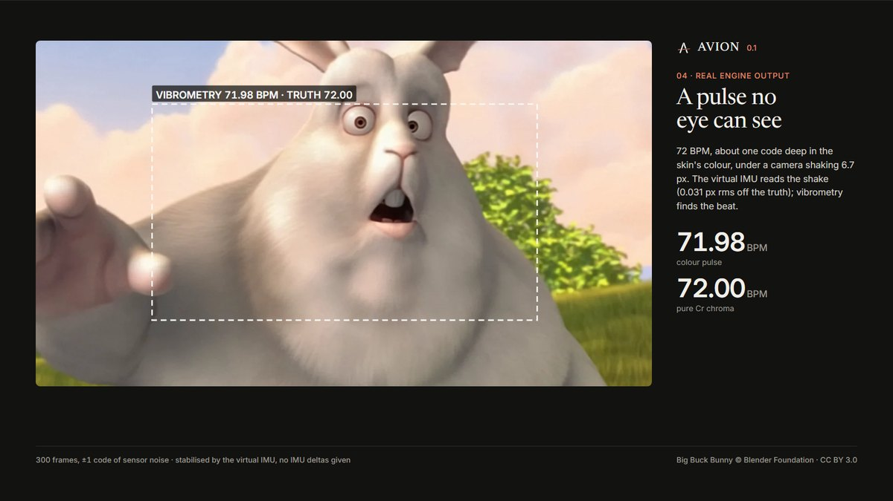

<p align="center"></p>

<div align="center">

# AVION

**A zero-allocation perception and media engine. C++20 and Direct3D 12 inside, one C99 header outside.**

<a href="LICENSING.md"></a>
<a href="docs/benchmarks.md"></a>
<a href="tools/linux/gcc.sh"></a>
<a href="docs/benchmarks.md"></a>
<a href="docs/sdk.md"></a>

[**Site and demo reel**](https://5645hm-a11y.github.io/avion/) · [Whitepaper](https://5645hm-a11y.github.io/avion/whitepaper.html) ·
[Benchmarks](docs/benchmarks.md) · [Architecture](docs/architecture.md) · [C99 SDK](docs/sdk.md) · [Packages](https://5645hm-a11y.github.io/avion/#download)

</div>

AVION plays video and reads it the way a machine needs it. It gives the camera's own shake with no gyro, the horizon,
objects with track ids and time to contact, an emulated event-camera stream, a remote pulse, scene cuts read from the bitstream
before decoding, and NCHW tensors for a model. Everything runs on the GPU, and once the engine is running it allocates nothing.

> **Dual-licensed.** Free under the [GNU AGPLv3](LICENSE): use, study, change and ship AVION, if what you ship (or serve over
> a network) is AGPLv3 too and its users get the source. A **commercial licence** from Alexandre Heymann is needed to embed it
> in closed-source software, in devices (drones, robots, vehicles, cameras, medical and industrial equipment) or in a service
> without publishing your source. Terms: [LICENSING.md](LICENSING.md). Contributions: [CONTRIBUTING.md](CONTRIBUTING.md)
> (the CLA is inside).

## What it sees

Each picture is a snapshot the engine wrote through its own C99 SDK, with the truth we set printed beside what it measured.
Footage: *Big Buck Bunny* © Blender Foundation, CC BY 3.0, or a generated scene whose truth is known.

<table>
<tr>
<td width="50%"><br><b>Shadow lift + neural 2×.</b> A forest three stops under: mean luma 30 → 69, highlights untouched, 11.4 ms on a UHD 630.</td>
<td width="50%"><br><b>Auto-horizon + tracked targets + TTC.</b> Tilt read +4.06° for +4.00°; time to contact 1.24 s for a true 1.33 s.</td>
</tr>
<tr>
<td width="50%"><br><b>Stabilised event-camera spikes.</b> A shaken clip: 17.2 M events, 1.71 M once the virtual IMU removes the camera's own motion.</td>
<td width="50%"><br><b>A pulse through camera shake.</b> A synthetic 72 BPM about one code deep: 71.98 BPM read, 72.00 from Cr chroma alone.</td>
</tr>
</table>

## Why it exists

Media players were designed around passive playback: read bytes, push them through layers of objects, put pixels on a
screen. AVION is built for software that has to act on video while it plays: robots, drones, smart cameras, the AI pipelines
behind them, and players that must seek without a stall. The engine follows a few rules strictly
([docs/ENGINE_MANIFESTO.md](docs/ENGINE_MANIFESTO.md) states them in full):

- **No third-party media code.** There is no FFmpeg, libav, libVLC, libmpv, SDL, Boost or Qt. The engine uses only the
  operating system: Win32, COM, Direct3D 11/12, DXGI, DirectComposition, WASAPI, and Media Foundation's own decoders where the GPU
  has no silicon for a codec.
- **No heap allocation in steady state.** Memory is committed at start-up in `LinearMemoryArena`s (`VirtualAlloc`, pages
  touched in advance). The arenas are sealed before playback, and a later request fails instead of falling back to the heap.
  Every playback test runs under an allocation probe, and a single allocation fails it.
- **Lock-free stages.** The demuxer, decoder, audio, clock and presentation stages talk only through single-producer
  single-consumer rings with acquire/release ordering, each cursor on its own 64-byte cache line. The rings carry 64-byte
  descriptors, never pixels.
- **GPU-first.** Decoded pictures stay in VRAM. Colour conversion, scaling, tone mapping, the neural upscaler and perception's
  passes run on the GPU's timeline.
- **One clock.** A second-order phase-locked loop follows the WASAPI endpoint's position and paces the swap chain. The tests
  count every dropped picture.

## Architecture

```
 file / HTTP range / camera
          │  IOCP or WinHTTP block source: leases on arena chunks (no copy)
          ▼
   Demuxer (MP4/MOV, Matroska/WebM)  ── SPSC: 64-byte MediaPacket ──►  Decoder (D3D12 Video: H.264, HEVC 8/10-bit;
          │                                                             Media Foundation for AV1 when the GPU has none)
          │                                                                    │ VideoFrameDescriptor (surface + fence)
          ▼                                                                    ▼
   AAC / Opus (platform MFT) ─► DSP ─► WASAPI      PLL clock ◄────── Renderer: NV12/P010 → RGB, tone map, scaling,
                                                                     perception passes, HUD and subtitles (SDF), present
```

| Path | What is there |
|---|---|
| [`include/media/core`](include/media/core) | The arena, the SPSC ring, the 64-byte descriptors: the rules above, in code |
| [`src/demux`](src/demux) | ISO BMFF (with fragments, edit lists, a compact pooled index for multi-hour files) and Matroska/WebM (Cues, lacing, unknown-size clusters) |
| [`src/codec`](src/codec) | H.264 and HEVC syntax parsers (SPS/PPS/slice headers, DPB, POC, reference lists) for D3D12 Video and for bitstream perception |
| [`src/render`](src/render) | The Direct3D 12 renderer, colour pipeline, HDR tone mapping, the neural upscaler and their HLSL |
| [`src/video`](src/video) | Perception: flow, time to contact, objects, the virtual IMU, stabilisation, horizon, vibrometry, event camera, tensors |
| [`src/engine`](src/engine) | The playback coordinator (the windowed engine) and the host-driven engine |
| [`src/sdk`](src/sdk), [`include/media/c_api.h`](include/media/c_api.h) | The C99 SDK (API 17): one header, an opaque handle, storage the host provides |
| [`apps`](apps), [`tests`](tests) | The demo and test driver, and the CTest suites |
| [`tools`](tools) | Benchmarks against ffmpeg/OpenCV/VLC, fixture generators, the Python and NuGet packages, the site |
| [`docs`](docs) | Design notes and measurements for each part: [seeking](docs/seeking.md), [network](docs/network.md), [Matroska](docs/matroska.md), [picture](docs/picture.md), [session](docs/session.md), [benchmarks](docs/benchmarks.md), [engine notes](docs/engine-notes.md) |

## Measured head to head

These were measured on one machine (Intel Core i7-10700, UHD 630) with the same inputs. One malloc-counting library was
preloaded into every process, so an allocation counts the same in AVION, ffmpeg and OpenCV. Lower is better. The method, raw
lines and scripts are in [`docs/benchmarks.md`](docs/benchmarks.md) and [`tools/bench`](tools/bench).

| Measure | AVION 0.1 | Baseline | Baseline tool |
|---|---:|---:|---|
| Heap allocations per 1,000 frames, 4K HEVC scan | **0** | 132,292 | ffmpeg 8.0.1, decode + scdet |
| Heap allocations per 1,000 frames, motion | **0** | 20,000 | OpenCV 4.10.0 DIS ultrafast |
| CPU per 4K HEVC frame to find cuts | **0.23 µs** | 31.1 ms | ffmpeg decode + scdet, one thread |
| Motion estimation, 640×480, one core | **0.51 ms** | 4.35 ms | OpenCV DIS ultrafast |
| Structure-tensor survey, 640×480 | **0.179 ms** | 0.779 ms | OpenCV |
| Player CPU while playing, 720p | 8.44 % | 23.90 % · **7.66 %** | ffplay · VLC (VLC uses less) |
| Player CPU while paused | **0.00 %** | 0.16 % · 0.00 % | ffplay · VLC |

The scan rows compare reading slice headers with decoding every pixel. That is the point of inspecting the bitstream before
decoding, not a decoder race. AVION's motion step works on 8×8 tiles and also yields time to contact and objects, so it does not
produce DIS's output.

| Engine figure | Result |
|---|---|
| Seeks in a 10-minute B-picture MKV over HTTP, with Cues at the end and an auth header required | 5 of 5 exact landings, 0 dropped, 0 out of order, 0 allocations, 35 % of the file read |
| 4K60 HDR10 HEVC playback on a UHD 630 | 0 pictures dropped, tone-mapped on the GPU |
| Window stabilisation (virtual IMU, no gyro) | 14.73 → 0.92 px rms of jitter on screen |
| Host-driven GPU decode into shared D3D11/D3D12 textures | 0.7 % of one core for H.264, 6.8 % for 4K HDR10 HEVC |

## Build

**Windows** (the full engine). You need Windows 10 or 11 x64, a Direct3D 12 GPU with D3D12 Video decoding, Visual Studio 2026
(MSVC, C++20), and CMake 3.24 or later. Nothing is downloaded.

```powershell
cmake -S . -B build -G "Visual Studio 18 2026" -A x64
cmake --build build --config Release
ctest --test-dir build -C Release --output-on-failure        # Serial: GPU playback tests compete under -j.
build\Release\media_player_demo.exe video.mkv                # Play a file, or an http(s):// URL.
```

Every target builds with `/W4 /WX`. `--target avion` builds `avion.dll`, and `--target avion_packages` builds the Python wheel and
the NuGet package.

**Linux** (the portable core: demuxers, codec syntax, clock, perception, DSP, the C99 SDK in host mode). You need GCC 13. Each
suite is built twice, at `-O2` and with ASan/UBSan, and run:

```bash
bash tools/linux/gcc.sh
```

**Test fixtures.** Synthetic fixtures are written by the suite itself (its fixture-making tests run first). The real-world ones are
generated with ffmpeg as a development tool (the engine never uses it): `tools/realworld/make_mkv_fixtures.py`
(Matroska/WebM, including the 198 MB HTTP seek file) and `tools/realworld/make_compat_matrix.py` (everyday MP4 variants).
Large third-party clips and datasets (Big Buck Bunny, Sintel, TUM VI) are fetched by their scripts under `tools/`. Tests whose
files are absent are not registered: a clean clone runs 229 tests and skips none.

## Quickstart: four ways in

**1. C99 / C++: a camera in, perception out** ([`tools/showcase/quickstart.c`](tools/showcase/quickstart.c), [SDK guide](docs/sdk.md))

```c
media_engine_config_t config;
media_engine_config_init(&config);
config.playback = MEDIA_PLAYBACK_HOST;           /* Your thread drives the engine. */
config.modules = MEDIA_MODULE_TELEMETRY;
media_engine_t* engine = NULL;
media_engine_create(&config, storage, media_engine_storage_bytes(), &engine);

media_sensor_config_t sensor;
media_sensor_config_init(&sensor);
sensor.width = W; sensor.height = H;             /* The arena is committed and sealed here. */
media_engine_open_sensor(engine, &sensor);

media_engine_ingest_video_frame(engine, &frame);              /* An NV12 frame from your camera: no allocation. */
media_query_frame_telemetry(engine, &telemetry);              /* TTC, objects, horizon, pulse, virtual IMU. */
media_export_foveated_tensor(engine, &request, tensor, sizeof tensor, &info);  /* NCHW float32/float16. */
```

**2. Direct3D 11/12: the GPU decodes into your textures, zero copies** ([texture output](docs/sdk.md))

```c
config.playback      = MEDIA_PLAYBACK_HOST;
config.output_flags  = MEDIA_OUTPUT_TEXTURE;      /* H.264 / HEVC decoded on the GPU into 3 shared textures. */
config.output_width  = 3840; config.output_height = 2160;
config.output_format = MEDIA_OUTPUT_FORMAT_PQ10;  /* Or RGBA8, or SCRGB16 for an HDR compositor. */
media_engine_create(&config, storage, media_engine_storage_bytes(), &engine);
media_engine_open(engine, "film.mkv");

media_output_textures_t tex = { sizeof tex };
media_engine_query_output_textures(engine, &tex); /* NT handles: ID3D12Device::OpenSharedHandle (or D3D11 OpenSharedResource1). */

while (media_engine_step(engine, now_100ns()) == MEDIA_OK) {
    media_output_frame_t f = { sizeof f };
    if (media_engine_acquire_output_frame(engine, &f) != MEDIA_OK) continue;
    queue->Wait(engine_fence, f.fence_value);     /* GPU-side wait: no CPU blocks. */
    draw(textures[f.index]);
    queue->Signal(host_fence, ++host_value);
    media_engine_release_output_frame(engine, f.index, host_value);
}
```

**3. Python** (`pip install avion-0.1.0-py3-none-win_amd64.whl`, [tools/python](tools/python))

```python
import avion

with avion.AvionEngine() as engine:
    engine.open("clip.mkv")
    while engine.step():
        t = engine.telemetry()                         # Pulse, vibration, TTC, objects, virtual IMU.
        x = engine.export_foveated_tensor(224, 224)    # numpy.asarray(x): a view, no copy.
```

**4. .NET 8** (`Avion.Sdk` NuGet package, [tools/nuget](tools/nuget))

```csharp
using var host = new AvionHost(textureWidth: 1920, textureHeight: 1080, outputFormat: Native.OutputFormatPq10);
host.Open("clip.mp4");
var clock = System.Diagnostics.Stopwatch.StartNew();
while (host.Step(clock.Elapsed.Ticks))
    if (host.Acquire() is Native.OutputFrame frame) host.Release(frame.Index, 0);
```

To embed the player in your own window and drive it with commands, see [samples/](samples) (C# WinForms and Python tkinter
players).

## Formats

MP4/MOV and MKV/WebM. H.264 and HEVC (8 and 10-bit, HDR10/HLG) are decoded on the GPU. AV1 goes through Windows' own decoder
when the GPU has none (ENGINE_MANIFESTO.md, 2E). Sound can be AAC up to 5.1, Opus or PCM. Subtitles can be SRT, WebVTT, tx3g or ASS (text),
and chapters are read too. Files can be local or over HTTP(S) range requests with custom headers. VP9, AC-3, DTS, FLAC and
image subtitles are refused, each with a reason (`media_probe`).

## Verification

The figures here are measured, and the losses are published next to the wins. MSVC x64 `/W4 /WX`, CTest serial, with a browser
decoding video on the same iGPU: **246 / 246** in Release and in Debug. GCC 13 at `-O2` and with ASan/UBSan: **102 / 102**. A
fresh clone of this repository builds without a warning and passes 229 / 229 with nothing skipped (the other 17 need large or
third-party footage that is not in git).

## Licence

| | **GNU AGPL-3.0-only** ([LICENSE](LICENSE)) | **Commercial licence** ([LICENSING.md](LICENSING.md)) |
|---|---|---|
| Price | Free | From the author |
| Use, study, modify, ship | Yes, commercially too | Yes |
| Your own code | Must be AGPLv3, source offered to users, network services included | Stays closed |
| Devices, OEM, SaaS without source | No | Yes: drones, robots, vehicles, medical, industrial, cloud |
| Warranty, support | None | On terms |

Contact **Alexandre Heymann** through this repository or [the site](https://5645hm-a11y.github.io/avion/) for a commercial
licence. Contributions are welcome under the CLA in [CONTRIBUTING.md](CONTRIBUTING.md), which keeps both options possible.

Copyright © 2026 Alexandre Heymann.
