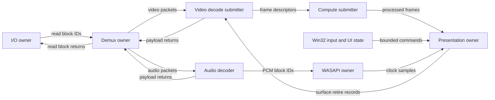

# Phase 1: architecture and Layer 0 contract

**Historical Layer 0 blueprint.** The cross-platform Layer 1 update is documented in [layer1.md](layer1.md). In particular, core headers are now portable, virtual-memory allocation is selected by native backend, and MP4/fMP4 demuxing plus the Windows IOCP source are implemented. The original Windows-specific proposals below remain design context rather than a description of every current source file.

Research checked 2026-09-24. This document distinguishes implemented primitives from the proposed media engine. Performance numbers below are budgets or arithmetic examples, not benchmark claims.

## 1. Engineering target and feasibility boundary

The useful architectural change is bounded ownership: pre-size application storage, transport small descriptions of that storage, and recycle only after every consumer has finished. It removes avoidable allocator traffic and synchronization from application code without claiming to remove synchronization from the machine.

| Requirement | Enforceable interpretation |
| --- | --- |
| Zero external libraries | Win32, native COM interfaces, D3D12/DXGI/DirectComposition, WASAPI, and C++ language/library facilities only. No third-party wrappers or codec libraries. Layer 0 only uses Win32 and allocation-free standard facilities. |
| Zero allocations during playback | No application storage allocation in steady-state streaming. Reserve/commit/touch CPU storage and create GPU heaps, resources, descriptors, pipelines, command allocators, and workers before entering Running. Seal CPU arenas. |
| Continuous arenas | CPU virtual addresses are contiguous within each arena. Physical RAM need not be contiguous. GPU resources require D3D12-managed heaps; ordinary `VirtualAlloc` memory cannot replace a GPU default heap. |
| Lock-free streaming | Each CPU edge has one producer and one consumer; queue calls have bounded work and contain no wait, lock, allocation, or retry loop. GPU dependencies use GPU timelines. |
| Zero unnecessary copies | CPU queues exchange resource descriptors; decoded pixels never return to CPU RAM. Compressed bitstreams still require GPU-visible input, and compute must read input and write output. |
| No stalls | No intentional CPU fence wait in the steady-state submission path. Hardware dependencies, resource contention, driver calls, and the Windows scheduler can still delay work. |

A literal guarantee of no process/kernel/driver allocation, no context switch, and no physical page fault is not deliverable by an ordinary Windows application. Drivers and system COM implementations manage private storage. Page touching removes initial demand-zero faults but Windows can later trim the working set. A playback profile must reject unsupported capabilities or leave Running to reconfigure; it must never silently grow a pool.

States: **Closed → Preparing → Primed → Running → Draining → Stopped**. Seeking changes the playback epoch through a coordinated transition. Resolution/profile changes beyond allocated limits, new font atlas pages, or model changes return to Preparing after retirement. GPU device loss and audio endpoint loss are recovered in place without leaving Running or touching the sealed arena: the device-bound objects are rebuilt at their prepared sizes while the playback epoch and clock continue ([recovery](recovery.md)). Allocation restrictions apply to Primed/Running; startup and teardown legitimately allocate and wait.

## 2. Compare mechanisms, not age or branding

It is inaccurate to say VLC, MPC, or mpv invariably decode on the CPU, bounce every frame through RAM, or use one monolithic object graph. mpv explicitly documents direct and copy-back hardware decoding modes; its settings also expose cases where a GPU-local copy is used. Those are capabilities of particular configurations, not proof that any player always incurs the cost. [mpv reference manual](https://mpv.io/manual/stable/)

The following are architectural failure modes to measure, rather than unmeasured accusations against named projects:

| Mechanism | Cost on modern hardware | Proposed response and tradeoff |
| --- | --- | --- |
| Heap-allocated packet graphs | Allocator work, scattered nodes, pointer-dependent cache misses, larger TLB working set; unpredictable tails | Contiguous descriptor rings and fixed payload blocks. Pay a known memory budget up front. |
| Virtual dispatch per tiny operation | Possible indirect branch misses and inhibited optimization; not intrinsically expensive compared with a full decode | Data-oriented stage functions over PODs. COM calls remain at necessary OS/GPU boundaries. |
| Shared work queues protected by locks | Contention, owner preemption, wakeup latency, cache-line migration | One SPSC edge per ordered stage pair. Separate queues for audio/video and every return path. |
| Adjacent read/write counters | Both cores invalidate one line despite touching different words | Separate publication counters and endpoint-local state into four 64-byte lines. |
| Small adjacent writable slots | Producer and consumer touch different objects on the same line | Round each slot to a cache-line multiple. Small message queues consume more RAM. |
| GPU readback then upload | Extra bus transfers and often a CPU/GPU synchronization point | Keep decoded images GPU-resident and sample plane SRVs from compute. |
| Deep presentation FIFO | Work is already queued when input arrives; latency increases with depth | Bounded frame contexts and admission based on fence completion and deadlines. |
| One OS thread for every tiny task | More scheduling overhead, coherence traffic, and oversubscription | Start with coarse stages; combine adjacent cheap stages if measurements favor locality. |
| Unbounded optional effects | AI and blur consume video/display deadlines | Reserve a base rendering budget; admit optional jobs only with headroom. |

For 3840 × 2160 NV12, nominal pixel storage is `W × H × 1.5 = 12,441,600` bytes. At 120 frames/s, one readback plus one upload moves approximately **2.986 GB/s** of pixel payload across the host/device boundary, excluding padding and protocol costs. This calculation applies only when such transfers actually occur. P010 doubles that nominal storage. An RGBA16F full-frame intermediate is 66,355,200 bytes, so even a fully GPU-resident design can become memory-bandwidth-bound.

Neither 64-byte alignment nor removal of virtual calls proves faster playback. Collect CPU cycles, cache misses, ready-thread latency, queue occupancy, GPU durations, presentation intervals, and underruns. Compare identical sources, adapters, settings, and power modes. Flip-model presentation can avoid costs of the older blit model; it is already a documented Windows mechanism, not an invention of this project. [Microsoft flip-model guidance](https://learn.microsoft.com/en-us/windows/win32/direct3ddxgi/for-best-performance--use-dxgi-flip-model)

## 3. Memory topology and admission

### CPU storage

One session arena contains fixed queue objects, resource/stream tables, read blocks, packet reassembly blocks, PCM blocks, codec syntax storage, and per-stage scratch partitions. The arena itself is used only during setup. Streaming stages recycle IDs inside these pre-existing regions, never bump the arena cursor. Separate immutable UI/session arenas are acceptable when their lifetimes differ; a single globally contended allocator is unnecessary.

`LinearMemoryArena` reserves and commits in one OS call, write-touches one byte per page, and retains the exact requested capacity separately from rounded commitment. Windows rounds committed sizes to pages; commitment alone does not materialize every physical page. [VirtualAlloc contract](https://learn.microsoft.com/en-us/windows/win32/api/memoryapi/nf-memoryapi-virtualalloc)

For a request of size `n` and alignment `a`, validate that `n > 0` and `a` is a nonzero power of two, then set `a = max(a, 64)`. With current absolute address `p`, padding is unsigned `(-p) & (a-1)`. Accept only if `padding <= remaining` and `n <= remaining-padding`. Aligning the absolute address supports alignments larger than the OS reservation granularity. Accounting includes requested bytes, padding, used/high-water bytes, successful requests, failed requests, and committed capacity. Failed requests consume no storage.

Typed construction begins C++ object lifetimes with `std::construct_at`; placement construction is not heap allocation. Only trivially destructible objects are accepted, so there is no hidden destructor list. Initialize/seal/shutdown and statistics access require a single owner or external quiescence. Shutdown uses the original base and size zero with `MEM_RELEASE`. [VirtualFree contract](https://learn.microsoft.com/en-us/windows/win32/api/memoryapi/nf-memoryapi-virtualfree)

### Capacity mathematics

Choose capacities from an admitted stream envelope, not average file size:

- For a stream arrival bound `A(t) <= sigma + rho*t`, and a maximum downstream service pause `J`, reserve at least `sigma + rho*J` units of buffering, rounded upward. Sustained service rate must exceed `rho`; buffering cannot fix sustained overload.
- Descriptor ring capacity is the next power of two at or above the maximum outstanding descriptor count. For 64-byte messages, the implemented ring uses `256 + 64*Capacity` bytes. Arbitrarily over-aligned message types may add control-to-slot padding.
- Payload pool size is block count times block bytes. Block count covers I/O in flight, parser retention, decoder retention, and return traffic. Maximum access-unit size and packet burst count are separate admission limits; bitrate alone does not bound them.
- Surface count has the conservative bound `N >= D + R + Qd + Qc + Qp + H`, where `D` is codec reference retention, `R` is additional reorder retention, `Q*` are in-flight stage budgets, and `H` is compute history. Account for overlap only when ownership proves it safe. Swap-chain buffers and compute intermediates are separate pools.
- Actual GPU sizes and placement alignments come from device allocation queries. `1.5WH`/`3WH` are pixel-payload estimates, not valid D3D12 heap allocation sizes.

Reject a source that exceeds the envelope, or stop and rebuild its session. On a full ring, retain the current lease and return to the stage's poll loop. Never overwrite queued packets. A return ring must hold the entire associated pool if the owner can be delayed indefinitely; this prevents retirement deadlock from an undersized return queue.

## 4. Ordered pipeline and ownership



Every arrow is a distinct SPSC queue; two returning stages never write the same queue. Additional reverse edges return PCM blocks and compute intermediates to their owners. A stage can poll several incoming queues, but each queue still has one reader. Shared ownership is represented by owner-local lease counts and separate return messages, not cross-thread COM reference counting per frame.

Use overlapped file reads with precreated handles, request records, and fixed buffers. An I/O owner polls completion and publishes only completed bytes. Disk operations can still enter the kernel or stall internally. Strict no-wait mode uses polling with the processor pause instruction; it burns CPU and is not a guarantee against preemption. Endpoint pacing for audio/display belongs at the boundary; an energy-saving mode with events would be a separate policy, outside the brief's strict polling constraint.

Most packets can reference an existing read block plus offset. A packet crossing block boundaries must use a bounded preallocated assembly block, or a future scatter/gather descriptor. This Layer 0 packet deliberately describes one contiguous span; it does not pretend all containers and hardware bitstream layouts can be parsed without any copy. If multiple packets reference one block, its owner returns it only after every lease retires.

Compressed video still needs codec-specific parsing: parameter sets, access-unit boundaries, reference lists, slice controls, and codec-dependent picture parameters. Native D3D12 decode is a hardware API, not a demuxer or a universal compressed-file decoder. The future implementation must handwrite each admitted container/parser and audio codec, or explicitly narrow its initial support. A native platform decoder whose private allocations are opaque cannot satisfy an audited application-storage policy by assumption. Layer 0 claims no codec support.

### Resource identity

`MediaPacket` carries PTS, DTS, duration, block ID/generation, offset/length, stream ID, codec-config ID, epoch, and flags. All times use signed 100 ns units; negative preroll is legal, `INT64_MIN` means unknown. Conversion from source time bases must use checked rational arithmetic; saturating timestamps silently would destroy scheduling. Unknown duration uses the same sentinel. A zero-initialized POD has zero timestamps, not unknown timestamps: producers must set semantic defaults explicitly.

`VideoFrameDescriptor` carries PTS/duration, a fence ID/value pair, surface ID/generation, epoch, base subresource, color-metadata ID, coded size, exclusive crop bounds, format, and flags. Validate `left < right <= width` and `top < bottom <= height`; the descriptor admits dimensions only through 65535. The owner-held table maps IDs to raw COM pointers, plane views, complete resource dimensions, and retirement state. Metadata records include primaries, transfer, matrix, range, chroma siting, aspect ratio, mastering metadata, and content-light levels. Metadata changes require a new retained table entry, not mutation under a consumer.

Epoch checks discard pre-seek work logically but never release storage still used by the GPU. Generations catch stale ID reuse; drain and restart before a 32-bit generation/epoch can wrap while any old handle exists. Fence values are 64-bit monotonically increasing per timeline. These PODs describe ownership; they do not themselves validate IDs or retire resources. They are in-process transport, not a packed file/network ABI.

## 5. SPSC ordering proof and cache behavior

Let conceptual unbounded producer/consumer sequences be `W` and `R`, capacity `C`, and occupancy `W-R`. Maintain `0 <= W-R <= C`. Slot index is sequence modulo `C`; because `C` is a power of two it is computed with `sequence & (C-1)`. The implementation stores unsigned 64-bit sequences, requires `C < 2^63`, and uses modulo subtraction. A stalled endpoint prevents the other from advancing more than the ring capacity, so relevant sequence differences never span the ambiguous half-range. Numeric counter wrap does not imply queue reset.

The producer owns `producer.next`, its cached read position, and checkout flag. The consumer owns the corresponding consumer fields. Only the two publication cursors are shared atomics, each on its own line. A slot is writable by the producer only after all earlier reads of that slot have completed.

1. Producer writes the slot's ordinary non-atomic fields, then release-stores the incremented write sequence.
2. Consumer acquire-loads that publication before reading newly published slots. That acquire observes the producer's writes.
3. Consumer completes its ordinary reads, then release-stores the incremented read sequence.
4. Producer acquire-loads that publication before overwriting recycled storage. That acquire observes completion of the prior reads.

Those paired relations provide the happens-before edges required to avoid data races. An acquire that observes a later producer release also covers all earlier writes sequenced before it, permitting cached boundaries. The producer refreshes its cached consumer cursor only when apparently full; the consumer refreshes its producer cursor only when apparently empty. Stale caches conservatively report unavailable work; they never authorize overwriting unread data. [C++ atomic ordering specification](https://eel.is/c++draft/atomics.order)

Acquire/release are explicit **language memory-order constraints**, not an instruction to emit an `MFENCE` on every operation. The compiler chooses the necessary target instructions; Windows x64 coherent normal memory generally needs ordered loads/stores rather than extra full fences here. `volatile` is not thread synchronization. CPU atomics do not replace D3D12 barriers or fence timelines.

Each call performs a bounded number of operations, with no compare/exchange loop. The static `is_always_lock_free` check rejects a platform implementation that would hide locks. This is a bounded try-operation API: successful end-to-end progress still depends on scheduling the peer. Repeated checkout/peek returns the outstanding pointer; invalid commit/release returns false. Callers must not access an old pointer after commit/cancel/release. This contract cannot prevent a caller from retaining an alias and misusing it.

The four control lines eliminate cursor false sharing under the stated 64-byte cache-line model, while padded slots eliminate adjacent-slot false sharing. Publication and slot handoff still cause necessary true sharing. Padding trades footprint and sometimes prefetch locality for predictable isolation; it does not eliminate cache misses or imply an optimal batch size.

## 6. GPU execution and compute/AI access

Preparation queries decode profile, coded size, format/plane shader access, feature tier, output color space, and resource budget on the selected adapter. Create decoder/heaps, upload storage, default heaps, placed surfaces, descriptor heaps, command pools, and precompiled shader pipelines before Running. Keep COM object ownership at session scope. D3D12 explicitly requires application management of reference frames and fence synchronization; capability support must be queried. [D3D12 video overview](https://learn.microsoft.com/en-us/windows/win32/medfound/direct3d-12-video-overview)

Use separate GPU timelines for copy/upload, video decode, compute, and graphics. A CPU descriptor becoming readable means its commands and dependency IDs are published, not that GPU pixels are ready. The proposed conservative handoff is:

1. Upload compressed data; signal the copy timeline when the decoder input is ready.
2. Decode queue waits on that dependency in GPU space, transitions output from COMMON to VIDEO_DECODE_WRITE, decodes, returns the shared display output to COMMON, and signals decode completion.
3. Compute queue waits on the decode timeline, transitions the output from COMMON to NON_PIXEL_SHADER_RESOURCE, and dispatches against plane SRVs. Output goes to preallocated UAV-capable intermediates. Apply UAV ordering where required, transition outputs for their next owner, then signal compute completion.
4. Graphics queue waits on the needed compute value, samples the processed frame, draws GPU UI into the current swap-chain buffer, transitions it to PRESENT, and signals completion for owned intermediate resources.
5. The resource owner polls all applicable completion values and reference/history leases before recycling. A graphics fence retires reads of an intermediate; DXGI separately controls reuse of swap-chain buffers. A queue slot release is neither of those events.

GPU queue waits express dependencies without making the submitting CPU wait for completion. They may still stall that GPU queue, so keep the graph acyclic and submit all producer signals before their dependents. Cross-queue synchronization and buffering are explicit D3D12 responsibilities. [Multi-engine synchronization](https://learn.microsoft.com/en-us/windows/win32/direct3d12/user-mode-heap-synchronization)

Do not transition a decode-reference surface to compute access while an overlapping decode operation still needs it in another state. Either serialize those uses with fences or query/support a separate shader-readable decode output alongside reference storage. Reference-only resources cannot simply be treated as arbitrary shader resources. If a device requires a GPU-local layout/conversion copy, declare that capability tier; strict direct-sampling mode rejects it. Resource flags and format support constrain SRV/UAV use. [D3D12 resource flags](https://learn.microsoft.com/en-us/windows/win32/api/d3d12/ne-d3d12-d3d12_resource_flags)

The compute color path is explicit: sample Y/chroma planes with correct siting and range, apply the stream's YCbCr matrix into nonlinear RGB, decode its transfer function, transform primaries in linear light, scale/filter, perform output-dependent tone mapping, then encode the selected output transfer. Choose the ordering of scaling relative to tone mapping deliberately. Use FP16/FP32 intermediates as accuracy and range require. HDR is not a single constant YUV matrix, and UI luminance must be defined in the selected output space.

An initial compute-only AI subsystem can use handwritten HLSL kernels, fixed weight buffers, preallocated activations, and explicit graph schedules. No ONNX runtime or external inference engine is implied. Texture-to-tensor packing and intermediate writes are GPU work and consume bandwidth; GPU residency does not make them free. Motion/interpolation retains history surfaces and adds lookahead latency, at least one source-frame interval for a bidirectional interpolator. Use a fixed maximum history, budgeted shader dispatches, and deterministic fallback to the base frame when optional work cannot meet its deadline.

A separate compute queue enables overlap only when the adapter has available execution/bandwidth capacity. Do not assume that it provides an independent GPU. Avoid enqueueing optional work ahead of mandatory presentation dependencies. Frame-context command allocators and upload regions are recycled only after their GPU uses complete. Command allocator reset while executing is undefined behavior. [Command allocator reset contract](https://learn.microsoft.com/en-us/windows/win32/api/d3d12/nf-d3d12-id3d12commandallocator-reset)

## 7. Hardware-referenced clock and PLL

The audio device is the master when audio is active. A WASAPI clock sample supplies device position `P_k` and correlated QPC time `Q_k`. Device position units are defined by `IAudioClock::GetFrequency`, not necessarily sample frames. `GetPosition` already returns QPC time in **100 ns units**, unlike raw `QueryPerformanceCounter`. Reject degraded `S_FALSE` readings instead of repeatedly retrying in a tight loop. [IAudioClock::GetPosition](https://learn.microsoft.com/en-us/windows/win32/api/audioclient/nf-audioclient-iaudioclock-getposition)

Define relative seconds to preserve precision:

`q_k = (Q_k - Q_0) / 10^7`

`y_k = t_anchor + (P_k - P_anchor) / F_audio`

Subtract integer anchors before floating conversion, validate monotonicity, and keep seek discontinuities out of these unsigned differences. For unit-rate playback with continuous audio, `y_k` is audible media time at `q_k`. Non-unit rate or inserted silence requires an explicit device-position-to-media-time mapping; do not assume each elapsed device second represents one source second after a seek or underrun.

Use a second-order alpha-beta clock estimator with phase `a` in seconds and rate `v` in media seconds per QPC second. For positive sample interval `dt`:

`a_pred = a_(k-1) + v_(k-1)*dt`

`e = y_k - a_pred`

`a_k = a_pred + alpha*e`

`v_k = clamp(v_(k-1) + (beta/dt)*e, 1-epsilon, 1+epsilon)`

For fixed `dt` and an unclamped, constant-rate clock, the homogeneous error transition in phase/rate-times-interval coordinates is

```text
M = [ 1-alpha    1-alpha ]
    [ -beta      1-beta ]
```

Its characteristic polynomial is `lambda^2 - (2-alpha-beta)*lambda + (1-alpha)`. The discrete stability conditions are `alpha > 0`, `beta > 0`, and `2*alpha + beta < 4`. Choose a repeated pole `r = exp(-dt/tau)`, giving `alpha = 1-r^2` and `beta = (1-r)^2`; both roots are `r`, inside the unit circle for `tau > 0`. At `dt=10 ms`, `tau=0.5 s`, this yields approximately `alpha=0.03921`, `beta=0.0003921`. These are initial tuning values, not measured device constants.

Use a nominal sample cadence, reject duplicate/backward samples, and recompute gains for modest positive timing jitter. The fixed-interval proof does not establish stability for arbitrary switched intervals, clamp saturation, or discontinuities. A proposed admission policy accepts intervals from 2 to 50 ms and phase innovations within 20 ms, bounds drift at ±1000 ppm, and requests reacquisition after three consecutive invalid samples. Pause, seek, device reset, or a larger gap re-anchor deliberately. These limits require device validation. Never smooth a seek as though it were oscillator drift.

For a candidate video timestamp `T`, predict its QPC deadline:

`q_due = q_k + (T - a_k)/v_k`

Submit at `q_due - L`, where `L` is a measured, bounded lead for compute, composition, and scanout prediction. Select frames in PTS order, decode in DTS order, and retain a fixed-size reorder table. Preserve the current frame if the next is early; skip stale frames according to duration-aware thresholds if late. VRR changes presentation opportunities, not the audio time base. If audio is absent, use a QPC master and measured display cadence. Underflow freezes or explicitly advances the media mapping according to the declared playback policy, rather than quietly corrupting A/V sync.

This is a software PLL disciplined by a hardware-referenced observation. It does not control the physical audio oscillator or establish Windows hard-real-time scheduling. Layer 0 provides timestamp transport; the PLL is the specified next-layer design.

## 8. Borderless GPU UI and presentation isolation

The Win32 owner handles the message pump, DPI, hit testing, keyboard navigation, accessibility, resizing, and window state. Its UI model is a fixed-capacity array of component records. It publishes bounded commands/snapshots to the presentation owner via its own SPSC queue. The render owner drains at most a configured command count per frame; producer-side coalescing collapses mouse moves and drag updates before publication. Never mutate a previously committed snapshot. Non-droppable commands retain pending producer state when full.

Rendering consumes the latest complete state, owns its animation state, and advances motion from measured time rather than frame counts. A stable retained visual tree and bounded GPU draw records prevent layout or text shaping from blocking presentation. Pre-rasterize glyph atlases and icons during preparation using Windows facilities or project assets; dynamic atlas growth requests a preparation transition. Accessibility providers expose the same semantic model while painting remains shader-based.

Use a borderless HWND with two explicitly different presentation profiles:

- **Composed desktop profile:** DirectComposition target/visual with a D3D12-backed composition swap chain. Pass the direct command queue, use FLIP_SEQUENTIAL and STRETCH as required, and premultiplied alpha when transparency is needed. Keep the composition visual tree stable. [CreateSwapChainForComposition](https://learn.microsoft.com/en-us/windows/win32/api/dxgi1_2/nf-dxgi1_2-idxgifactory2-createswapchainforcomposition)
- **Low-latency borderless profile:** HWND flip-model swap chain, composition into an opaque back buffer, and validated tearing/VRR support. Query support, create with ALLOW_TEARING, and present with sync interval zero plus the corresponding present flag only when valid. Composition, driver, display, and window conditions can still prevent the desired refresh behavior. [Variable-refresh requirements](https://learn.microsoft.com/en-us/windows/win32/direct3ddxgi/variable-refresh-rate-displays)

Do not promise that transparent DirectComposition visuals automatically retain independent flip or VRR. Select and measure a profile on the actual hardware. Bound submitted frames (start with two frame contexts and a presentation latency target of one, then validate throughput). Query frame-context fence availability before recording work; if none is available, retain the last image and continue servicing bounded work. Present itself can throttle or fail; CPU nonblocking admission cannot guarantee a nonblocking driver.

UI draws rounded geometry, borders, gradients, noise, and shadows with GPU pipelines. Glass over the player's content uses bounded downsampled blur intermediates; a shader cannot arbitrarily sample the desktop behind the window. Use supported compositor materials where available if desktop backdrop is required. Reserve a fixed blur radius/resolution budget. Typography and focus contrast must remain legible over changing video.

At 120 Hz the whole display interval is 8.333 ms. Budget GPU effects from measured percentiles, not from the assumption of 120 fps media. UI animation can refresh at display cadence while a 24 fps source retains the same decoded frame. Interactions update position/opacity/scale through GPU constants, preserve continuity on interruption, and honor reduced-motion settings. Resize/DPI/display-color changes that exceed prepared resource limits coordinate a drain and rebuild outside Running.

## 9. Validation and next integration gates

The supplied tests cover allocation errors and accounting, aligned and over-aligned storage, all usable ring slots, unpublished checkout, cancellation, held-reader backpressure, invalid double commit/release, repeated FIFO reuse, near-`UINT64_MAX` initialization, and multiword integrity across two native Windows threads. Stress capacities 1, 8, and 1024 move 200,000, 1,000,000, and 2,000,000 messages respectively, with deliberate producer/consumer pauses. Debug and Release builds keep test checks enabled independently of `NDEBUG`.

These tests are correctness evidence on the installed Windows x64 compiler/platform; they are not a formal proof of the compiler or a throughput benchmark. No GPU path, codec, PLL, or UI is implemented/tested in Layer 0. No whole-process heap-allocation trace has been claimed. Thread creation, test logging, and joining occur in the harness and are outside queue operations.

Before integrating playback, require:

1. Parser bounds/fuzz tests and checked timestamp rescaling for each admitted container/codec; malformed or oversized access units fail without pool growth.
2. Allocation instrumentation during steady-state traces, separating application-origin calls from runtime/driver calls; no hidden logging, string formatting, lazy shader compilation, or COM creation in stage loops.
3. GPU debug-layer validation of every plane/subresource state and cross-queue dependency, plus resource poisoning/generation checks after retirement.
4. Simulated clock drift, jitter, discontinuities, silence insertion, and audio-device loss tests against bounded A/V error targets.
5. ETW/PIX measurements of CPU scheduling, GPU overlap, frame pacing, queue depth, and end-to-end latency, with debug instrumentation disabled for performance baselines.
6. Long playback, seek storms, resizing, HDR changes, minimization, memory pressure, and device removal tests. Budget violations trigger explicit state transitions and preserve resource lifetime safety.

This keeps the strict requirements inspectable: Layer 0 guarantees its own storage and ordering behavior; each later layer must separately demonstrate that it preserves them.

## 10. Modules, the C SDK and cross-modal signatures (2026-10-21)

**Modules are arena regions.** The engine's optional subsystems (voice, HUD, subtitles, neural upscaling, chapters, telemetry) are `EngineModuleFlags` ([`EngineModules.hpp`](../include/media/engine/EngineModules.hpp)).
- Each enabled module gets one fixed region of the file arena, made first in `Preparing`, with a nested `LinearMemoryArena` view over it (`InitializeView`: no OS call). Every allocation of the module comes from its region.
- So the committed arena is exactly `ArenaBudget(modules)`: 192 MiB of core plus the regions, 239.1 MiB with all of them, against the fixed 256 MiB before.
- Leaving a module out removes exactly its region from the capacity and from the bytes in use, and starts none of its threads. The regions are multiples of 64 KiB, so the core's allocations move by whole pages and keep their alignment.
- Regions are sealed with the arena. A module that needs more than its region fails alone, as each optional subsystem already could, and playback continues.

**The SDK is a boundary, not a layer.** [`c_api.h`](../include/media/c_api.h) is C99: plain structs, enums and one opaque handle constructed in the host's storage (`media_engine_storage_bytes`). Behind it, [`CApiEngine.cpp`](../src/sdk/CApiEngine.cpp) holds a `PlaybackCoordinator` and maps the configuration onto `PlaybackOptions` (modules, wake policy, voice input, frame callback). The portable part ([`CApi.cpp`](../src/sdk/CApi.cpp): budgets, wake words, a configuration-only handle) builds on every platform. No heap anywhere: the handle lives in host storage, paths are converted into fixed buffers in it, and everything else comes from the arena.

**Cross-modal signatures reuse what already runs.** A frame signature joins two existing per-picture/per-block computations at the presentation point:
- the conversion's scene-statistics pass (mean luma; now also the brightest sample and the share of moving 8×8 blocks, from the same sample);
- the live cut detector;
- the DSP's spectral analysis (`SpectralTracker`, which the notch killer and the ducking need: band levels, dominant band, speech probability).

The renderer hands each picture's statistics to the coordinator as it flips it (`SetSignatureSink`). The coordinator adds the audio fields (atomics the worker publishes per block) and puts the 64-byte record into an SPSC ring for one poller. The host's callback runs after the presentation pass, so it may give commands.

**Picture stages stay out of the production shader.** Picture controls and micro-motion are compiled into variants of their own (`PICTURE_CONTROLS`), chosen only when `picture_flags` is set, as the split comparison is (`SPLIT_COMPARE`): code in the production conversion costs register allocation even when it never runs.
